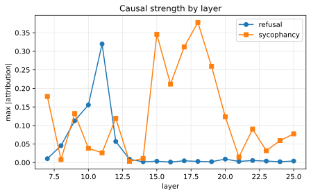
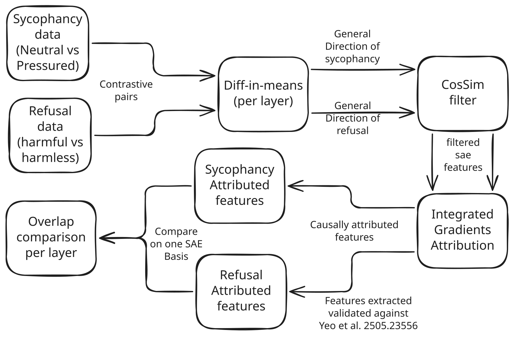

TL;DR

Refusal and sycophancy localized at different depths. Upon sweeping the model's layers I found that refusal peaks early (layer 11), and sycophancy peaks around (layer 18), and this led to investigating if they share top 10 causally-attributed features. I found zero overlap. This hints that sycophancy is safe to edit without touching refusal.

## Intro

**Sycophancy** is a behavior that shows up in base/pretrained models  [Not Just RLHF: Why Alignment Alone Won't Fix Multi-Agent Sycophancy](https://arxiv.org/abs/2605.12991), and it means that a language model falsely modifies its output to match the user's incorrect view. However, **refusal** is induced by aligning the model using RLHF [Refusal in Language Models Is Mediated by a Single Direction](https://arxiv.org/abs/2406.11717), by making the model refuse to answer or complete harmful requests. Prior work suggested that sycophancy and refusal steering vectors are oppositely aligned across different models [Analysing the Safety Pitfalls of Steering Vectors](https://arxiv.org/abs/2603.24543). So, sycophancy's steering vectors geometrically oppose refusal, meaning that sycophancy pushes the model away from safety. The authors adopted a one-dimensional vector as a proxy for the model's refusal space, however they noted the limitations of using such low dimension and called for future work toward using higher dimensional spaces such as sparse autoencoders. 
**Sparse AutoEncoders** **(SAE)** is a tool that takes the model's internal activity and breaks it down into separate, more understandable pieces. This led to the question: "Do sycophancy and refusal share space in a single SAE basis?". Beyond curiosity, this question is part of a two-question research project: the first question localizes behaviors to get a sense of how overlapping they are, and the second edits them in the SAE dimension and checks if this affects the model capability or introduces a jailbreak.
## Result

For each layer, I extracted the SAE features that causally drive sycophancy and refusal independently, and plotted the strongest causally-attributed feature for refusal and sycophancy at each layer. Here is what I found:

*   Refusal rises at layer 8 and peaks at layer 11.
*   Sycophancy rises at layer ~14-15 and peaks at layer 18.

This shows that in SAE's higher dimensionality sycophancy and refusal are localized at different depths.

To check for overlap, I filtered top k causally attributed features per layer for sycophancy and refusal where, k in {5,10,20} causally-attributed features, using threshold of 0.01 attribution. This table shows zero overlap for k = 10; the results were identical for k = 5 and k = 20.

| Layer | ref | syc | ∩   | Jaccard |
| ----- | --- | --- | --- | ------- |
| 7     | 1   | 3   | 0   | 0       |
| 9     | 8   | 4   | 0   | 0       |
| 10    | 9   | 1   | 0   | 0       |
| 11    | 3   | 1   | 0   | 0       |
| 12    | 2   | 2   | 0   | 0       |
| 13    | 0   | 0   | 0   | 0       |
| 15    | 0   | 4   | 0   | 0       |
| 17    | 0   | 6   | 0   | 0       |
| 18    | 0   | 3   | 0   | 0       |
| 20    | 0   | 4   | 0   | 0       |
| 25    | 0   | 3   | 0   | 0       |

This table confirms the localization of both behaviors. Note that layers 8, 14, 16, 19, 21-24 were omitted for better readability. Also, the figure shows the strongest single feature's attribution per layer; the table counts features above threshold, so the peak layers differ slightly.
## Method

### Setup

All experiments were conducted on [Llama 3.1 8B Instruct](https://huggingface.co/meta-llama/Llama-3.1-8B-Instruct) using LlamaScope for layers (7-25) ([llama_scope_lxr_8x](https://huggingface.co/OpenMOSS-Team/Llama3_1-8B-Base-LXR-8x/tree/main)).
### Dataset

*   **AdvBench** which contains harmful prompts, and **Alpaca** which contains harmless prompts were used for refusal.
*   **MMLU** (Massive Multitask Language Understanding) was used to create pairs of **neutral** and **pressured** prompts to check sycophancy.

### Diff-in-means

For extracting the general direction of both behaviors, I utilized difference in means between contrastive pairs. For sycophancy I used MMLU filtered on P(correct)>0.8, then for these points, I appended the pressure sentence "three other AIs agreed on (random wrong answer)" after the questions and choices using the structure from [Not Just RLHF: Why Alignment Alone Won't Fix Multi-Agent Sycophancy](https://arxiv.org/abs/2605.12991). This creates contrastive pairs: one neutral and one pressured. I cached post layer residual stream for each layer from (7-25) for **neutral** and **pressured** examples, then I extracted the mean of the residual stream for neutral and pressured. Then, I subtracted mean(**neutral**) from mean(**pressured**) giving the general direction of sycophancy. The same was done to extract the general refusal direction, I utilized AdvBench (harmful prompts) and Alpaca (harmless prompts). Then, I cached post layer residual stream for both datasets. Then, I got the mean for harmful and harmless runs. Finally, I subtracted mean(**harmless**) from mean(**harmful**) giving the general refusal direction.
### CosSim on SAE features

I hooked SAEs to layers (7-25), then inspired by [Understanding Refusal in Language Models with Sparse Autoencoders](https://arxiv.org/pdf/2505.23556) CosSim + AP, I filtered SAE's decoder features to the set that has high cosine similarity to that layer's diff-in-means direction. So, now we have a subset of SAE features that are highly aligned with the behavior.
### Integrated Gradients (IG)

Here comes the activation patching part, where Integrated Gradients (IG) is used to attribute the model's output to specific features. A simpler method would be a single-point gradient that measures the gradient at a local point assuming linearity in a complex non-linear model. However, sliding the features from clean to corrupt activation measures the actual effect of this feature. This is backed by the completeness axiom from the paper [Axiomatic Attribution for Deep Networks](https://arxiv.org/abs/1703.01365), which states that the sum of model attributions across all features should equal the difference between the model's output for an input and its output for a baseline, ensuring total prediction margin accountability. This property makes IG a better choice compared to standard attribution patching (AP), as it helps better identify causally attributed features and their exact contribution to the model's output.
## Validation

I was able to reproduce the features from the paper [Understanding Refusal in Language Models with Sparse Autoencoders](https://arxiv.org/pdf/2505.23556). Features 7015, 23677, 26994, and 19920 at layers 10-11 were found to be causally attributed to refusal. This gave me confidence that my pipeline is working as expected allowing me to do the same for sycophancy.
## What the features actually are

To confirm that these features are indeed responsive to the behaviors, I conducted control experiments on the top causal feature. For refusal, I ran max-activating token search for feature 10503 at layer 11. It fires hardest on the decision token `<|eot_id|>` for examples representing harmful prompts like identity theft, hacking secure systems, and exploiting software vulnerabilities. The feature fired with 23.75, 22.12, and 21.88 respectively for these examples. When I ran harmless prompts even ones that have similar lexical content like virus vs worm, the feature remained as low as 2.98. So, this feature indeed responds to harmful prompts rather than surface-level tokens. The same was done for sycophancy where I ran max-activating token search for feature 3094 at layer 18. However, the findings were less clear. As the feature fired on the decision token after the pressured sentence "three other AIs agreed on (random wrong answer)" which is immediately downstream of the jury-pressure sentence. However, the feature also fired on logic/math notation on neutral prompts. As a control, I fixed the position of the activation inspection to the decision token and checked the values for the neutral and pressured examples. So, when compared on the same spot, the feature fired with 1.02 for pressured and 0.096 for neutral. This shows that the feature is indeed responsive to the pressured sentence rather than surface-level tokens.
## Limitations

*   The claim is that sycophancy and refusal do not share residual-stream SAE features, however, cross-layer interactions were not considered.
*   LlamaScope is an SAE trained on Llama 3.1 8B Base, and I am applying it to Llama 3.1 8B Instruct.
*   The sycophancy feature is polysemantic meaning that editing this specific feature may cause other behaviors to be affected.

## Conclusion

The limitations mentioned are real caveats, but the zero overlap between both behaviors still stands. This hints that the safe edit of sycophancy is possible.
## What's next

This is part 1 of a bigger research project. Knowing that sycophancy and refusal do not share the same causal features, I will move on to the next question: "Can we suppress sycophancy without affecting refusal?". So, I will be investigating how to intervene on the sycophancy features to suppress the behavior and check if refusal or overall model performance is affected.