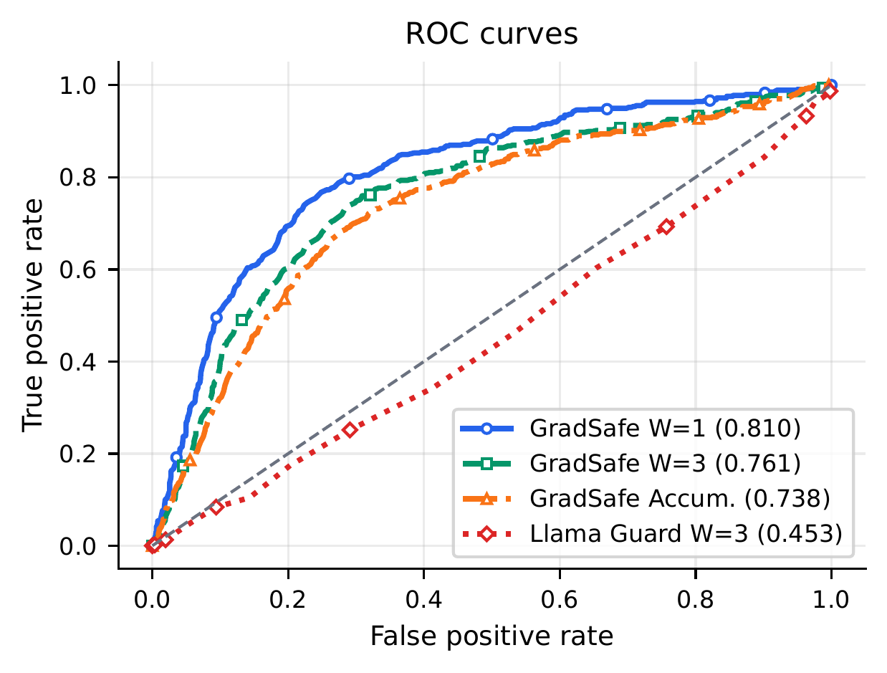

TL;DR

Our paper on gradient-based jailbreak detection in multi-turn dialogue was accepted at [CCS-LAMPS 2026](https://lamps2026-ccs.github.io/home/) and is on [arXiv](https://arxiv.org/abs/2609.36849). When evaluated against synthetic benign conversations, the detector achieves an ROC-AUC of 0.98 against human-authored multi-turn jailbreaks. When evaluated on WildChat benign conversations, ROC-AUC decreases to 0.76, and a threshold calibrated on synthetic data incorrectly classifies more than 90% of benign conversations as unsafe.

## Why

Safety-aligned language models are commonly deployed as multi-turn assistants, allowing adversaries to distribute unsafe intent across several user turns rather than expressing it in a single prompt. Existing gradient-based jailbreak detectors, such as GradSafe, were developed for single-prompt inputs. They detect unsafe prompts by measuring the alignment between an input-induced gradient and a fixed unsafe reference direction; however, their effectiveness in multi-turn dialogue remains unclear. This gap motivates a central question: when malicious intent is distributed across a dialogue, does the internal unsafe gradient signature remain detectable, weaken, or disappear?

What a gradient-based detector reads: the model's surprise at saying "Sure"

  <button type="button" id="gsw-prev">Back</button>
  <button type="button" id="gsw-next">Next</button>
  <button type="button" id="gsw-play">Play</button>
  |
  Input:
  <button type="button" data-kind="unsafe" aria-pressed="true">harmful request</button>
  <button type="button" data-kind="benign" aria-pressed="false">benign request</button>

<svg id="gsw-svg" viewBox="0 0 640 300" role="img" aria-label="Five-step sketch of GradSafe scoring: input plus Sure, loss, gradient arrow, reference arrow, cosine score"></svg>

A sketch. The gradient lives in the space of the model's safety-critical parameters, drawn here as a plane; the arrows, angles and scores are illustrative. The scoring rule is the paper's Eq. 1: the cosine between the input's gradient and a fixed unsafe reference direction.

## What we did

We extend GradSafe with a Context Window Scanner that applies the detector to fixed-size windows of user turns and uses the maximum window score as the conversation-level score. We evaluate different window sizes, attack families, benign conversation distributions, and target models, on 537 human-authored multi-turn jailbreak (MHJ) conversations and 2,000 WildChat benign conversations sampled to match the MHJ turn-length distribution.

How the Context Window Scanner scores a conversation

  Window size:
  <button type="button" data-w="1" aria-pressed="true">W=1</button>
  <button type="button" data-w="2" aria-pressed="false">W=2</button>
  <button type="button" data-w="3" aria-pressed="false">W=3</button>
  <button type="button" data-w="7" aria-pressed="false">Accumulated</button>
  <button type="button" id="cws-play">Play</button>

<svg id="cws-svg" viewBox="0 0 640 275" role="img" aria-label="Six user turns scored with a sliding window; the conversation score is the maximum window score"></svg>

The six turns and their scores are illustrative. The ROC-AUC shown for each window size is the paper's measured value on MHJ attacks versus WildChat benign conversations (Table 3).

## What we found

*   The results show a substantial difference between synthetic and realistic benign settings. When evaluated against synthetic benign conversations, the detector achieves an ROC-AUC of 0.98 against human-authored multi-turn jailbreaks. When evaluated on WildChat benign conversations, ROC-AUC decreases to 0.76, and a threshold calibrated on synthetic data incorrectly classifies more than 90% of benign conversations as unsafe.
*   Under realistic benign distributions, single-turn windows provide the highest separability, whereas longer windows and accumulated conversation contexts reduce performance. A long conversation does not call for scoring its whole history; if anything, the extra length only creates more room for dilution.
*   The detector is also sensitive to the attack-generation method and target model: successful Crescendo-generated attacks receive scores comparable to or lower than benign conversations, and evaluation on Qwen2.5-7B-Instruct yields near-random separability with a different optimal window size.

## What it means

These findings show that gradient-based signals can support multi-turn jailbreak detection, but reliable deployment requires calibration on realistic benign conversations, short-window scoring, length-aware thresholds, and evaluation across attack types and model architectures.

## Paper

Omar Sheta, Rinku Deuja, Hadi Masoudi, and Minghong Fang. *Does the Unsafe Gradient Survive a Conversation? On the Fragility of Gradient-Based Jailbreak Detection in Multi-Turn Dialogue.* LAMPS '26, the 3rd ACM Workshop on Large AI Systems and Models with Privacy and Security Analysis, co-located with ACM CCS 2026. [arXiv:2609.36849](https://arxiv.org/abs/2609.36849). I will present it remotely at the workshop on November 15.
